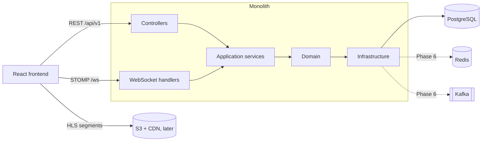

# Architecture

## Style: modular monolith
One deployable, nine modules with explicit boundaries, one PostgreSQL database. Chosen over microservices because the domain boundaries are still being learned; extraction is cheap later **if** modules do not reach into each other's tables or classes. Alternatives: microservices now (operational cost, distributed transactions before they are needed). Trade-off: one scaling unit until extraction.

## Module layout
Each module `com.cineplay.<module>` has four internal packages (an improvement on a flat controller/service/repository split, because it keeps each module's public surface small):
- `api` – controllers, request/response DTOs, WebSocket handlers (the only package other layers expose over HTTP)
- `application` – use-case services, transactions, authorization checks
- `domain` – entities, domain rules, repository interfaces
- `infrastructure` – JPA/Redis/Kafka/S3 adapters

Rules: modules talk through `application` interfaces or events, never through another module's `domain`/`infrastructure`; entities never leave a module (DTOs only). Enforce later with an ArchUnit test.

`common/` holds cross-cutting code only: `response` (envelope), `exception`, `security`, `config`.

## Module responsibilities
auth (register/login/JWT/refresh) · user (profile, preferences, history, favourites) · movie (catalogue, search) · streaming (stream metadata, signed URLs) · room (lifecycle, membership, capacity, playback state) · chat · notification · admin · analytics (the last three consume events, Phase 6).

## Key decisions (details come with each phase)
- **Schema owned by Flyway**; Hibernate runs in `validate` mode.
- **Room capacity** is enforced in the database: one atomic `UPDATE watch_rooms SET participant_count = participant_count + 1 WHERE id = ? AND participant_count < max_participants AND status IN (...)`; 0 rows updated means full. Combined with the `(room_id, user_id)` primary key for idempotent joins and a CHECK constraint as a last line of defence. Alternatives: pessimistic `SELECT ... FOR UPDATE` (simple, serialises per room), optimistic `@Version` (retries under contention), Redis counter (extra failure mode). This works across multiple instances, unlike `synchronized`.
- **Playback is server-authoritative**: server assigns `seq`, clients never supply the authoritative timestamp.
- **Video bytes never pass through Spring Boot**: API returns (signed) URLs to object storage/CDN.
- **Redis/Kafka are on the classpath but unused** in Phase 1; Redis health is off by default so the app starts without them.

## Roadmap
1. Foundation (this delivery) → 2. Auth + users → 3. Movies → 4. Rooms + concurrency tests → 5. WebSocket playback + chat → 6. Redis + Kafka (+ outbox) → 7. CI/CD, Prometheus/Grafana → 8. Extraction plan, gateway, Kubernetes.
